# 🏋️ ApexFit — ENTREGA 4: Frontend Angular Integrado

> **Corporación Universitaria Antonio José de Sucre**  
> **Programa de Ingeniería de Sistemas**  
> **Curso:** Electiva Profesional II – Grupo AG  
> **Docente:** Jaider Javier de la Rosa Bertel  
> **Integrantes:**  
> - Luis Fernando Rios Barboza  
> - Roni Andres Mendiz Barrios  
> - Raul Andres Peralta Perez  
> - Gerneidis Requena Berrio  
> - Jose David Ortega Barrios  
> **Fecha de Entrega:** 12/11/2026  

---

## 📌 1. Introducción y Objetivos

**ApexFit** es un sistema web de gestión integral para gimnasios y centros de entrenamiento: control de membresías, rutinas personalizadas, seguimiento de progreso físico y registro de asistencia mediante código QR, soportando tres roles de usuario (**Cliente**, **Entrenador** y **Administrador**).

El objetivo de la **Entrega 4** es contar con una interfaz funcional en **Angular 22** que consuma el **backend real** (Spring Boot con MySQL en AWS RDS), sin datos simulados (*mocks*).

---

## 🔗 2. Entregables y Enlaces Oficiales

| Entregable | Enlace / Ubicación |
|---|---|
| **Repositorio General (Monorepo)** | [https://github.com/josedavidortegabarrios9-code/apexfit](https://github.com/josedavidortegabarrios9-code/apexfit) |
| **Repositorio del Frontend** | [https://github.com/josedavidortegabarrios9-code/apexfit/tree/main/apexfit/apexfit-frontend](https://github.com/josedavidortegabarrios9-code/apexfit/tree/main/apexfit/apexfit-frontend) |
| **Repositorio del Backend** | [https://github.com/josedavidortegabarrios9-code/apexfit/tree/main/apexfit/apexfit-backend](https://github.com/josedavidortegabarrios9-code/apexfit/tree/main/apexfit/apexfit-backend) |
| **Aplicación Desplegada en Producción** | [https://apexfit-demo-1er.vercel.app/login](https://apexfit-demo-1er.vercel.app/login) |
| **Documento Original Word (.docx)** | [`ENTREGA 4 - Frontend Angular Integrado.docx`](./ENTREGA%204%20-%20Frontend%20Angular%20Integrado.docx) |

---

## 🧱 3. Estructura Modular del Proyecto Angular

El código está concebido como un workspace multi-proyecto con tres sub-proyectos donde cada funcionalidad vive en su propia carpeta. En **Angular 22** se emplean **componentes standalone** cargados bajo demanda (*lazy loading* con `loadComponent`), cumpliendo el papel de módulos desacoplados:

| Proyecto | Tipo | Para quién | Contenido | Puerto local |
|---|---|---|---|:---:|
| `app-usuarios` | Aplicación | Clientes | 7 pantallas privadas (*Hoy, Rutina guiada, Rutina, Mi QR, Asistencia, Progreso, Mi cuenta*) y 3 públicas (*Login, Registro y Recuperar contraseña*). | `4200` |
| `panel-administrativo` | Aplicación | Administrador y Entrenador | 10 pantallas: *Resumen, Asistencia, Inactividad, Usuarios, Asignaciones, Membresías, Ejercicios, Mis clientes, Nueva rutina y Mis rutinas*. | `4201` |
| `shared` | Librería | Ambas apps | Sesión, guards, interceptor JWT, pantalla de login, Mi cuenta y campana de notificaciones. | — |

### Organización interna en cada aplicación:
* `pages/<funcionalidad>/`: Una carpeta por pantalla conteniendo su `.ts`, `.html`, `.scss` y prueba unitaria `.spec.ts`.
* `data/`: Acceso a datos desacoplado de la vista:
  - `*.service.ts`: Llamadas HTTP con `HttpClient`.
  - `*.mapper.ts`: Transforman DTOs del backend a modelos de la interfaz y viceversa.
  - `*.models.ts` y `dtos.ts`: Tipos e interfaces TypeScript.
  - `errores.ts`: Manejo y traducción de mensajes de error.
  - `carga.ts`: Estados reactivos de carga.
* `layout/`: Estructura de navegación (menú lateral y barra inferior).

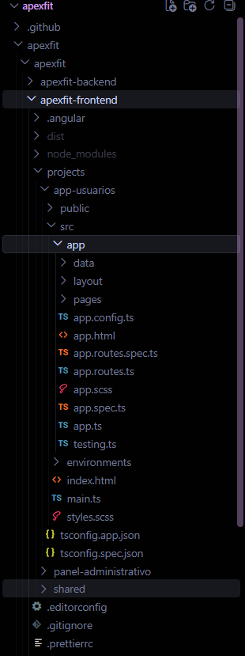
*Figura 1: Estructura del proyecto Angular multi-aplicación.*

---

## 🖥️ 4. Componentes para Vistas Principales (CRUD Completo)

| Funcionalidad | Listar | Crear | Editar | Eliminar | Rol que la gestiona |
|---|:---:|:---:|:---:|:---:|---|
| **Usuarios** | Sí | Sí | Sí | Sí | Administrador |
| **Asignaciones Entrenador-Cliente** | Sí | Sí | Sí *(cambio de estado)* | Sí | Administrador |
| **Ejercicios** | Sí | Sí | Sí | Sí | Administrador y Entrenador |
| **Rutinas y Ejercicios** | Sí | Sí | Sí | Sí | Entrenador |
| **Membresías** | Sí | Sí *(crear y renovar)* | Sí | No *(se gestiona por estado)* | Administrador |
| **Progreso y Medidas** | Sí | Sí | Sí | No | Cliente |
| **Asistencia** | Sí | Sí *(manual y por QR)* | Sí *(hora de salida)* | No | Administrador y Cliente (consulta) |
| **Notificaciones** | Sí | Backend automático | Sí *(marcar leída)* | Sí | Todos los roles |
| **Configuración** | Sí | — | Sí *(días inactividad)* | — | Administrador |
| **Sesión de Entrenamiento** | Recuperar avance | Guardar avance | Sí | — | Cliente |

### Evidencia de Vistas Principales:

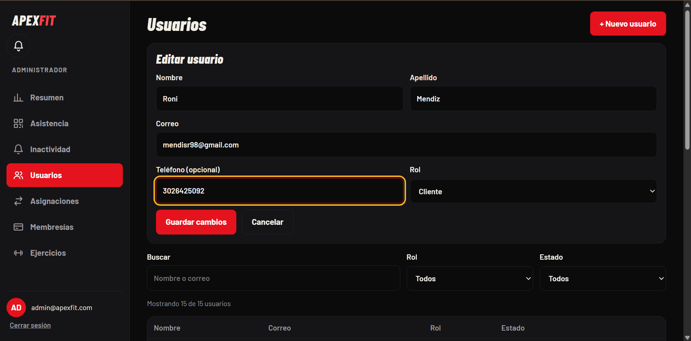
*Figura 2: Cambio de número de teléfono en edición.*

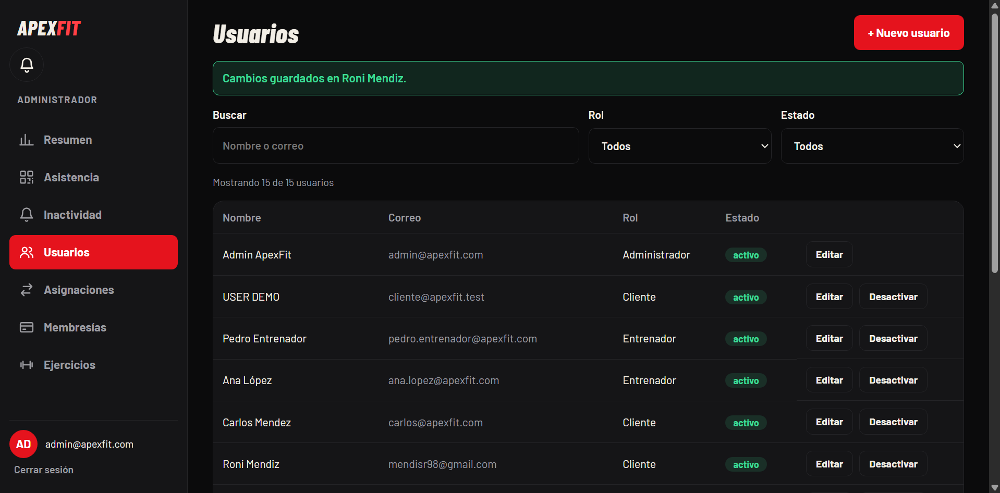
*Figura 3: Notificación de confirmación de cambios guardados.*

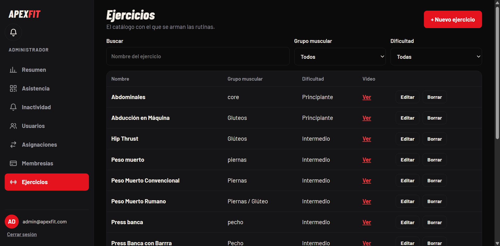
*Figura 4: Operaciones CRUD completas en el catálogo de Ejercicios.*

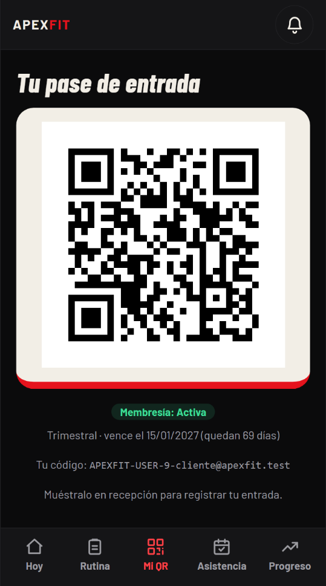
*Figura 5: Vista Hoy (Resumen del día del cliente).*

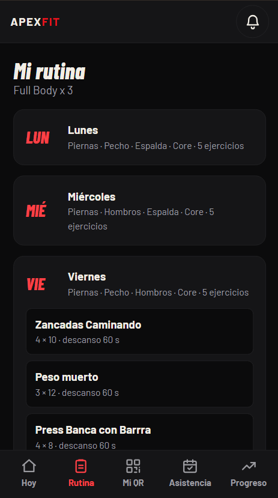
*Figura 6: Visualización de Rutina de entrenamiento.*

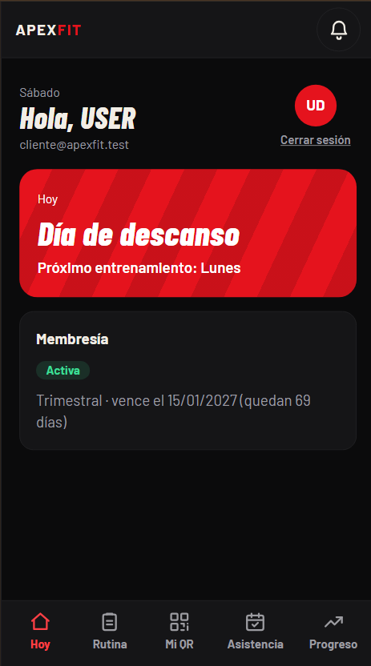
*Figura 7: Generación de credencial digital con Código QR.*

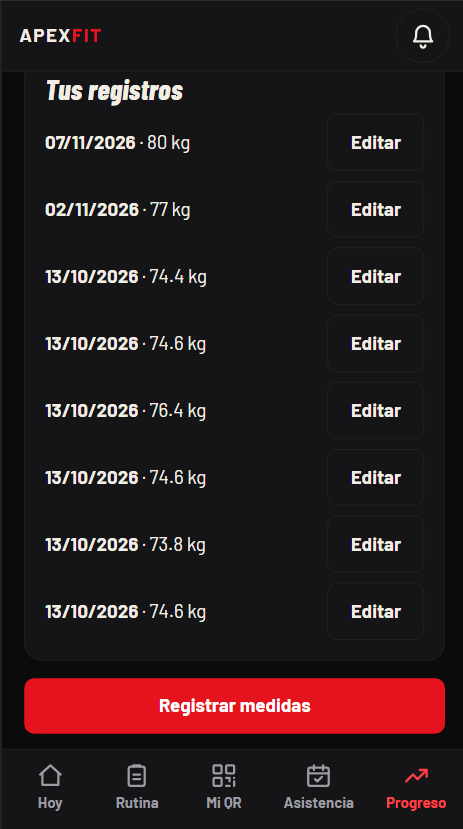
*Figura 8: Historial y registro de progreso antropométrico.*

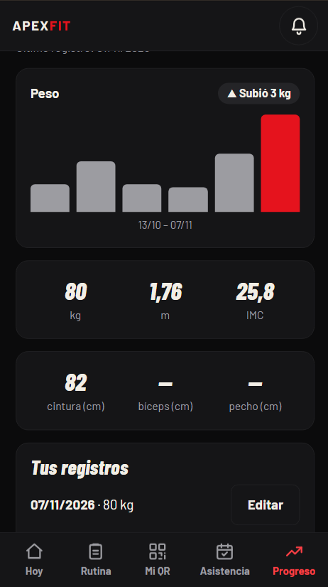
*Figura 9: Métricas de evolución física y medidas corporales.*

---

## 🌐 5. Servicios Angular con HttpClient Integrados al Backend

Los servicios consumen la API REST real de Spring Boot sin ningún tipo de datos simulados (*mocks*):

| Módulo del Backend | Endpoints que consume el Frontend |
|---|---|
| **Inicio de Sesión** | `POST /api/v1/auth/login` |
| **Registro** | `POST /api/v1/auth/register` |
| **Recuperación de Contraseña** | `POST /api/v1/auth/solicitar-recuperacion` y `POST /api/v1/auth/resetear-password` |
| **Perfil** | `GET /api/v1/usuarios/perfil` |
| **Usuarios** | `GET` y `POST /api/v1/usuarios`, `PUT` y `DELETE /api/v1/usuarios/{id}` |
| **Asignaciones** | `GET`, `POST /api/v1/entrenador-cliente`; `PUT`, `DELETE /api/v1/entrenador-cliente/{id}`; `GET /api/v1/entrenador-cliente/entrenador/{id}` |
| **Membresías** | `GET` y `POST /api/v1/membresias`, `GET /api/v1/membresias/usuario/{id}`, `PUT /api/v1/membresias/{id}` |
| **Asistencias** | `GET` y `POST /api/v1/asistencias`, `POST /api/v1/asistencias/escanear-qr`, `GET /api/v1/asistencias/usuario/{id}`, `PUT /api/v1/asistencias/{id}` |
| **Dashboard** | `GET /api/v1/dashboard/resumen` |
| **Ejercicios** | `GET` y `POST /api/v1/ejercicios`, `GET`, `PUT` y `DELETE /api/v1/ejercicios/{id}` |
| **Rutinas** | `GET` y `POST /api/v1/rutinas`, `GET /api/v1/rutinas/cliente/{id}`, `PUT` y `DELETE /api/v1/rutinas/{id}` |
| **Ejercicios de la Rutina** | `POST /api/v1/rutina-ejercicios`, `GET /api/v1/rutina-ejercicios/rutina/{id}`, `PUT` y `DELETE /api/v1/rutina-ejercicios/{id}` |
| **Progreso** | `POST /api/v1/progresos`, `GET /api/v1/progresos/usuario/{id}`, `PUT /api/v1/progresos/{id}` |
| **Notificaciones** | `GET /api/v1/notificaciones`, `GET /api/v1/notificaciones/no-leidas/contador`, `PUT /api/v1/notificaciones/{id}/leida`, `PUT /api/v1/notificaciones/leidas`, `DELETE /api/v1/notificaciones/{id}` |
| **Configuración de Inactividad** | `GET` y `PUT /api/v1/configuracion/inactividad` |
| **Sesiones de Entrenamiento** | `GET` y `PUT /api/v1/sesiones-entrenamiento/hoy` |

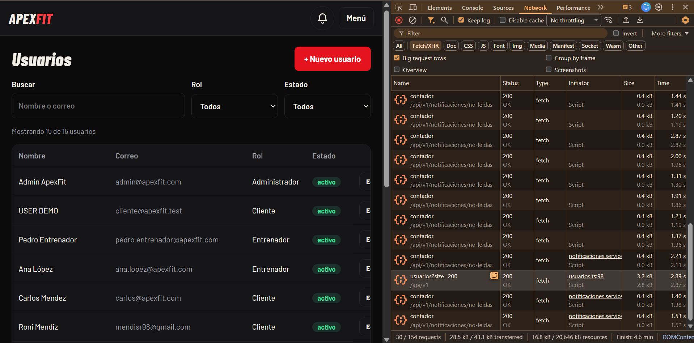
*Figura 10: Consumo real de la API de usuarios mediante HttpClient.*

---

## 📝 6. Formularios Reactivos con Validaciones (ReactiveFormsModule)

Se implementaron **11 componentes** con `ReactiveFormsModule`: *Inicio de sesión, Registro, Recuperación de contraseña (2 pasos), Mi cuenta (cambio de contraseña), Progreso, Usuarios, Membresías, Asignaciones, Ejercicios, Nueva rutina y Mis rutinas*.

| Formulario | Validaciones Principales |
|---|---|
| **Registro** | Nombre, apellido, correo y contraseña obligatorios; correo válido; contraseña mínimo 6 caracteres; teléfono de 7 a 15 dígitos. |
| **Recuperar Contraseña** | Correo válido; nueva contraseña mínimo 6 caracteres y coincidencia exacta en confirmación. |
| **Usuarios (Panel)** | Campos obligatorios, formato de correo, longitudes máximas y patrón de teléfono. |
| **Membresías** | Cliente y plan obligatorios; precio > 0; fecha de fin posterior a fecha de inicio. |
| **Progreso** | Fecha no futura; peso y altura en rangos biológicos válidos; perímetros opcionales con límites. |
| **Ejercicios** | Nombre obligatorio con longitud máxima; enlace de video con formato URL válido. |
| **Nueva Rutina y Mis Rutinas** | Nombre obligatorio; series y repeticiones numéricas válidas dentro de rango. |

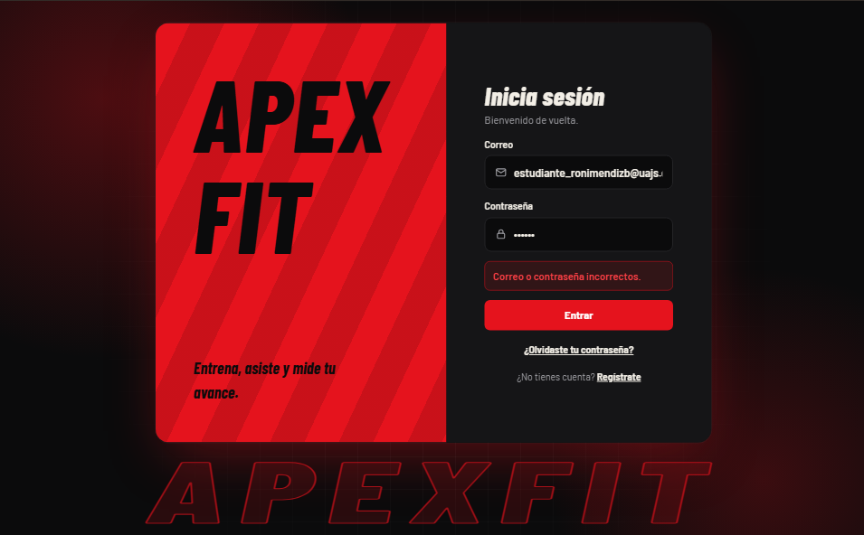
*Figura 11: Feedback visual de validaciones reactivas antes del envío.*

---

## 🧭 7. Enrutamiento (Angular Router) y Guards por Rol

Ambas aplicaciones emplean `Angular Router` con carga bajo demanda (*lazy loading*) y títulos dinámicos:

| Aplicación | Rutas Públicas | Rutas Privadas |
|---|---|---|
| **`app-usuarios`** | `/login`, `/registro`, `/recuperar` | `/hoy`, `/entrenar`, `/rutina`, `/mi-qr`, `/historial`, `/progreso`, `/cuenta` |
| **`panel-administrativo`** | `/sesion` *(recibe sesión desde login)* | `/resumen`, `/asistencia`, `/inactividad`, `/usuarios`, `/asignaciones`, `/membresias`, `/ejercicios`, `/clientes`, `/rutinas`, `/mis-rutinas`, `/cuenta` |

Cualquier ruta inexistente (`**`) redirige a la vista inicial correspondiente al rol del usuario.

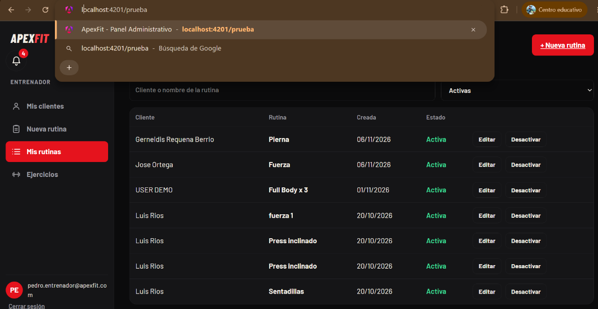
*Figura 12: Intento de acceso a ruta inexistente.*

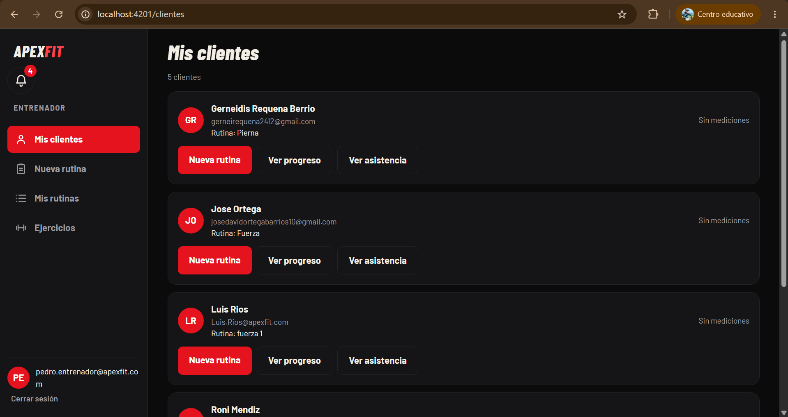
*Figura 13: Redirección automática controlada a la ruta principal.*

### Guards de Seguridad:
| Guard | Función y Responsabilidad |
|---|---|
| `accessGuard` | Exige sesión activa y valida que el rol pertenezca a la app; si no, redirige al login. |
| `guestGuard` | Para login, registro y recuperación: si ya hay sesión activa, redirige al inicio. |
| `rolGuard(...)` | Limita rutas específicas del panel a roles autorizados; si el usuario no tiene permisos, lo devuelve a su inicio. |
| `inicioGuard` | Redirige la raíz del panel a la primera opción de menú del rol autenticado. |

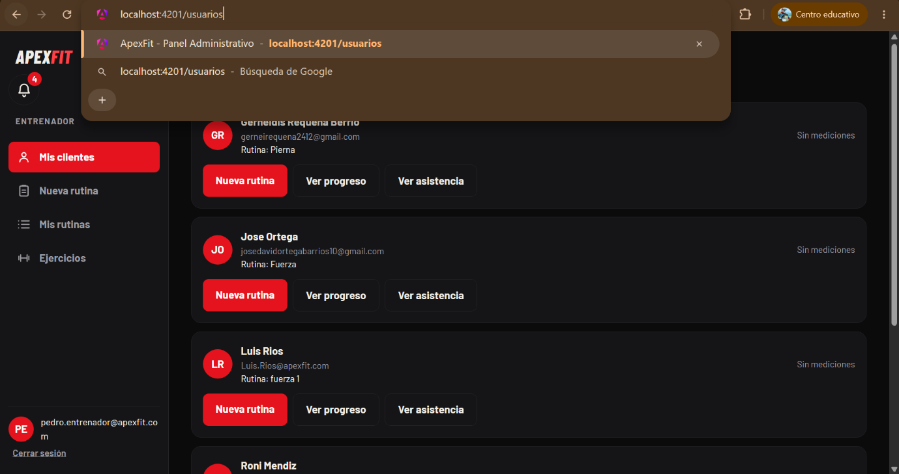
*Figura 16: Control de acceso - Entrenador intenta acceder a la gestión de usuarios (solo admin).*


*Figura 17: Entrenador redirigido automáticamente a su vista permitida (Mis Clientes).*

---

## 🔐 8. Implementación de Autenticación, JWT e Interceptor HTTP

1. El usuario digita correo y contraseña en `app-usuarios` y se envía a `POST /api/v1/auth/login`.
2. El backend devuelve el token **JWT**, id y roles. El frontend persiste la sesión y la reutiliza en las subsiguientes llamadas.
3. Si el rol es **Cliente**, ingresa directamente a `app-usuarios`. Si es **Entrenador** o **Administrador**, es transferido automáticamente al `panel-administrativo`.
4. El interceptor HTTP (`auth.interceptor.ts` en `shared`) adjunta la cabecera:
   ```http
   Authorization: Bearer <token_jwt>
   ```
   a todas las peticiones (excepto las públicas `/auth/*`). Si el backend responde `401 Unauthorized` (token vencido), invalida la sesión y retorna al login.

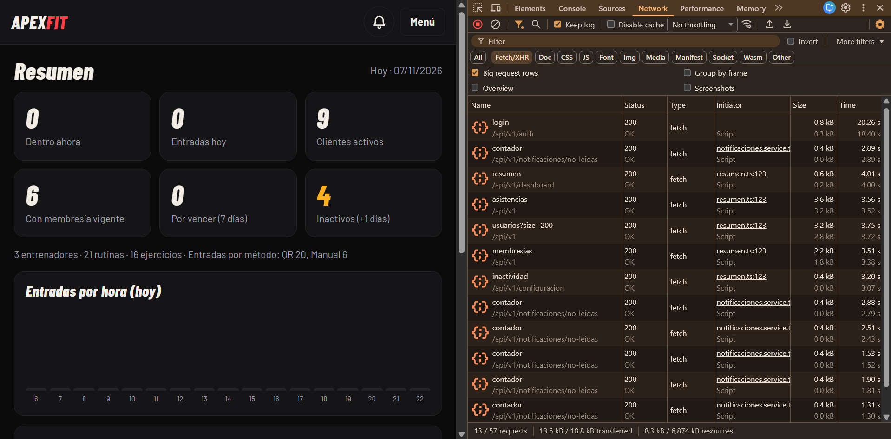
*Figura 14: Inicio de sesión contra la API real de autenticación.*

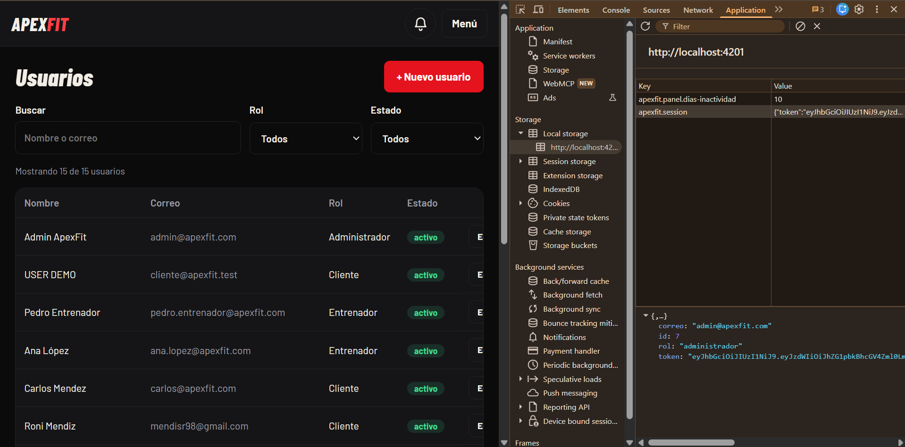
*Figura 15: Token JWT y datos de sesión persistidos en el cliente.*

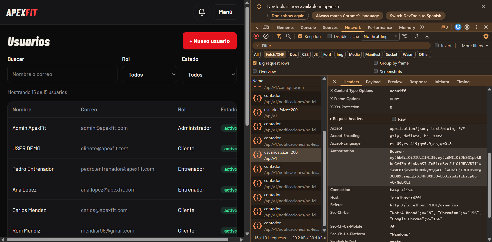
*Figura 18: Interceptor HTTP inyectando automáticamente la cabecera Authorization.*

---

## ⚠️ 9. Manejo de Errores y Feedback Visual al Usuario

* **Estados de Vista:** Cada pantalla que consume datos maneja 3 estados: *cargando (spinner)*, *error con botón Reintentar*, y *estado vacío* cuando no existen registros.
* **Traducción Amigable:** Funciones `mensajeDeError` y `mensajeDeGuardado` transforman códigos HTTP en mensajes en español:
  - `0`: Sin conexión al servidor.
  - `400`: Datos inválidos con el detalle campo por campo.
  - `403`: Acceso denegado (sin permisos suficientes).
  - `404`: Recurso no encontrado.
* **Accesibilidad:** Uso de atributos `role="alert"` y `role="status"` para lectores de pantalla.

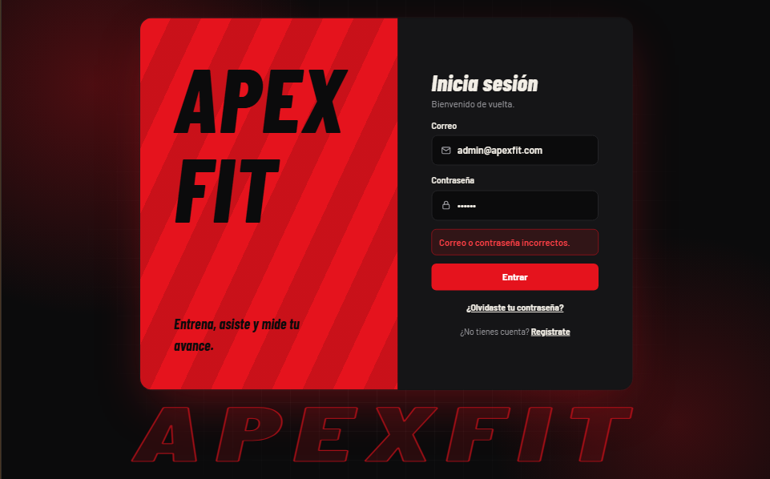
*Figura 19: Mensaje de error controlado ante credenciales incorrectas.*

---

## 📱 10. Diseño Responsive y Adaptabilidad

* **CSS Propio con Tema Centralizado:** Paleta de colores consistente, tipografías y variables de diseño en `_theme.scss`.
* **15 Reglas `@media`:** Puntos de corte optimizados entre 400 y 900 px.
* **`app-usuarios` (Mobile-First):** Barra de navegación inferior, tarjetas *full-width* y botones táctiles amplios.
* **`panel-administrativo` (Desktop & Tablet):** Sidebar lateral colapsable, menú superior desplegable en pantallas pequeñas, tablas adaptativas y formularios responsivos.

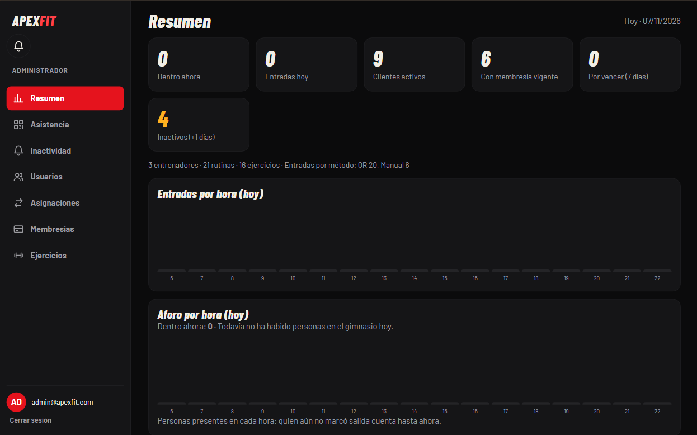
*Figura 20: Vista del Panel Administrativo en pantalla de escritorio.*

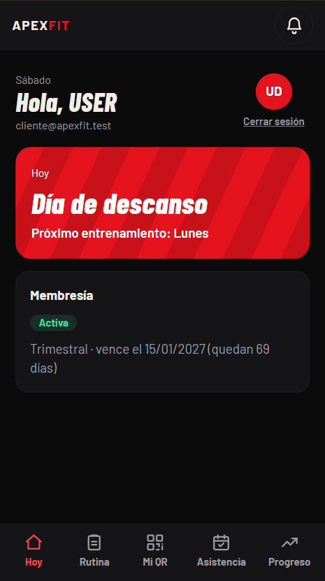
*Figura 21: Vista responsive adaptada a dispositivos móviles.*

---

## 🧪 11. Evidencia de Cero Mocks y Pruebas Unitarias

1. **Sin Datos Simulados:** Todo el código productivo consume directamente los endpoints del backend en `/api/v1`.
2. **Base de Datos Cloud:** El backend opera contra MySQL en **AWS RDS**.
3. **Suite de Pruebas Unitarias:** Más de **540 tests unitarios en 69 archivos** ejecutados con Vitest y jsdom utilizando dobles de prueba controlados para `HttpClient`.

---

## 📚 12. Referencias Bibliográficas

* Angular. (s. f.). *Control route access with guards*. Recuperado de [https://angular.dev/guide/routing/route-guards](https://angular.dev/guide/routing/route-guards)
* Angular. (s. f.). *Form validation*. Recuperado de [https://angular.dev/guide/forms/form-validation](https://angular.dev/guide/forms/form-validation)
* Angular. (s. f.). *Interceptors*. Recuperado de [https://angular.dev/guide/http/interceptors](https://angular.dev/guide/http/interceptors)
* Angular. (s. f.). *Reactive forms*. Recuperado de [https://angular.dev/guide/forms/reactive-forms](https://angular.dev/guide/forms/reactive-forms)
* Jones, M., Bradley, J., & Sakimura, N. (2015). *JSON Web Token (JWT) (RFC 7519)*. Internet Engineering Task Force. [https://www.rfc-editor.org/rfc/rfc7519](https://www.rfc-editor.org/rfc/rfc7519)

